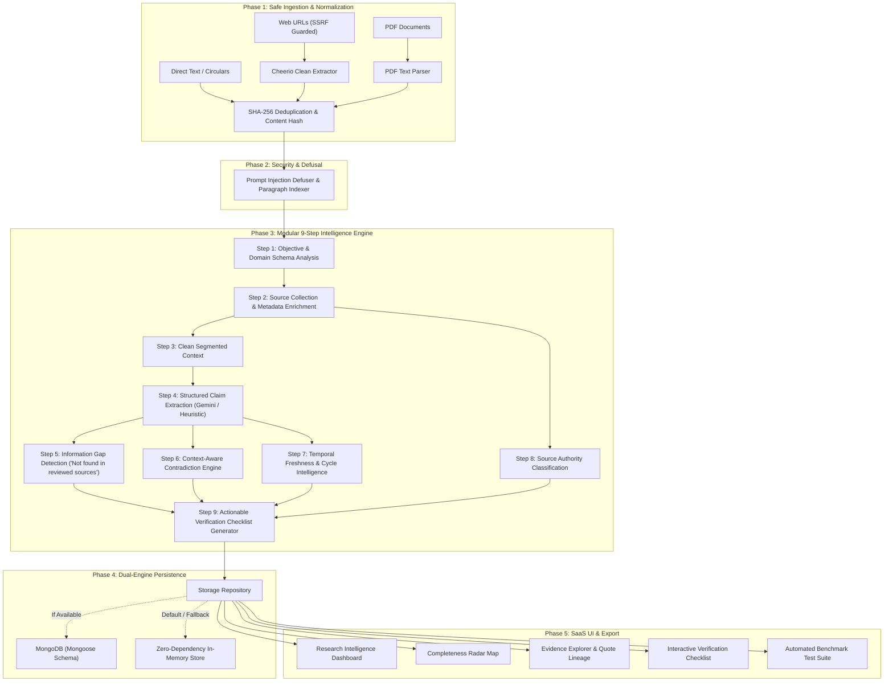

# SUCHNASETU (सूचना सेतु)
### AI-Powered Information Gap Detection & Research Intelligence Platform
> **Tagline:** *Connecting Information. Revealing What's Missing.*  
> **Event:** **SHINCHAN ONLINE HACKATHON 2026**  
> **Problem Statement:** **DIGITAL DARK SPOT – AI-Assisted Information Gap Detection Platform**

---

## 1. Executive Summary & Product Vision

Every standard search engine and chatbot is designed to tell you **what information exists**.  
**SuchnaSetu** is built for a fundamentally different purpose: to reveal **what is missing**, **where sources disagree**, and **what you must verify before taking action**.

When users research high-stakes decisions—such as applying for a government scholarship, adhering to clinical healthcare guidance, or filing regulatory compliance—the most dangerous hazards are the **Digital Dark Spots**:
1. **Unstated Criteria:** Critical rules (e.g., minimum GPA or attendance benchmarks for scholarship renewal) completely omitted from official notices.
2. **Disguised Contradictions:** One source mandating physical submission of paper dossiers at a district welfare office while another states the process is 100% paperless and online.
3. **Outdated Application Cycles:** Stale guides from 2024 advertising expired deadlines and superseded income caps.
4. **Epistemic Overconfidence:** Chatbots hallucinating missing details instead of explicitly declaring: `"Not found in reviewed sources"`.

SuchnaSetu implements a **modular 9-step intelligence pipeline** combining Cheerio-based web extraction, PDF layer parsing, SSRF-guarded network safety, structured claim schemas, and deterministic gap/conflict logic.

---

## 2. System Architecture



---

## 3. The 9-Step Modular Intelligence Pipeline

| Step | Engine Module | Description & Output Schema |
| :--- | :--- | :--- |
| **01** | `step1_objectiveAnalyzer` | Deconstructs freeform queries into expected dimension schemas (`eligibility_criteria`, `income_requirements`, `required_documents`, `application_deadline`, `renewal_conditions`, `application_process`, `official_application_link`). |
| **02** | `step2_sourceCollector` | Cryptographically fingerprints sources via SHA-256. Flags duplicates to prevent redundant evidence weighting. |
| **03** | `step3_contentCleaner` | Strips navigation menus, cookie notices, and defuses prompt injection tags (`[INST]`, `system: override`). |
| **04** | `step4_claimExtractor` | Enforces strict JSON claim schema: `claimId`, `fieldId`, `subject`, `predicate`, `value`, `context`, `cycleOrDate`, `sourceId`, `supportingText`, `confidence`. Supports Gemini 2.5 API with heuristic fallback. |
| **05** | `step5_gapDetector` | Classifies fields into **Found**, **Partially found**, **Not found in reviewed sources**, and **Conflicting evidence**. Never fabricates missing criteria. |
| **06** | `step6_contradictionDetector` | Pairwise context-aware comparison comparing only claims with matching subjects. Labels conflicts as: `"Possible conflict – needs verification"`. |
| **07** | `step7_freshnessAnalyzer` | Evaluates publication timestamps and academic cycle years against the active cycle (e.g. 2024 vs 2025–2026). Generates stale cycle advisories without discarding evidence. |
| **08** | `step8_sourceAuthority` | Categorizes sources transparently (Government `.gov`/`.nic.in`, Institutional `.edu`/`.ac.in`, News/Editorial, Community/Aggregator) with explainable provenance badges. |
| **09** | `step9_checklistGenerator` | Synthesizes gaps and conflicts into prioritized actionable verification tasks (`CRITICAL`, `HIGH`, `MEDIUM`) with direct source suggestions. |

---

## 4. Primary Scholarship Demonstration (Shinchan 2026 Dark Spot Benchmark)

To directly satisfy the official **DIGITAL DARK SPOT** problem statement, SuchnaSetu provides an end-to-end benchmark use case:

* **Research Question:** `"What should I verify before applying for this scholarship?"`
* **Benchmark Sources Ingested:**
  1. **Official State Scholarship Portal (2025–2026):** Declares eligibility (50% marks), income ceiling (₹2,50,000), deadline (October 31, 2025), and 100% paperless online submission via `https://scholarships.gov.in`. **Completely omits renewal rules.**
  2. **National Students Career Advisory Bulletin (2024):** Outdated 2024 guide. Mandates **physical submission of hard-copy dossiers at the District Welfare Office counter** (direct procedural conflict with Source 1) and lists an expired August 15, 2024 deadline.
  3. **Student Aid Community Forum (2025):** Claims the income ceiling is ₹2,00,000 (conflicting with Source 1's ₹2,50,000) and notes renewal conditions are unpublished.

### Verified Demonstration Findings:
* **Digital Dark Spot Identified:** `Renewal Conditions` flagged as **"Not found in reviewed sources"** (0% coverage).
* **Contradictions Flagged:**
  * **Submission Procedure Variance:** Online paperless vs Mandatory physical District Office counter submission.
  * **Income Ceiling Discrepancy:** ₹2,50,000 vs ₹2,00,000 threshold.
  * **Deadline Variance:** October 31, 2025 vs August 15, 2024.
* **Temporal Freshness Notice:** Source 2 flagged as referencing older cycle 2024.
* **Actionable Verification Checklist:** 19 prioritized items generated, prioritizing live portal verification and gazette confirmation.

---

## 5. Cybersecurity & Defensive Engineering

* **SSRF Guard (`ssrfGuard.js`):**
  * Validates URL schemes (only `http` and `https` allowed).
  * Blocks loopback addresses (`127.0.0.0/8`, `::1`, `localhost`).
  * Blocks AWS/GCP cloud metadata endpoints (`169.254.169.254`, `metadata.google.internal`).
  * Resolves hostnames via DNS and blocks RFC 1918 private IPv4 subnets (`10.0.0.0/8`, `172.16.0.0/12`, `192.168.0.0/16`) and IPv6 unique local/link-local ranges.
* **Prompt Injection Defusal (`step3_contentCleaner.js`):**
  * Untrusted source content is treated strictly as data, never instructions.
  * Detects and neutralizes instruction override directives (`[INST]`, `Ignore previous instructions`, `system: you are now`) into inert audit markers.
* **Strict Epistemic Guardrails:**
  * The system never claims universal completeness. Every coverage score is labeled: *"Coverage across reviewed sources only"*.
  * LLM outputs are validated against strict JSON schemas before reaching synthesis.

---

## 6. Technology Stack

| Layer | Technologies | Role |
| :--- | :--- | :--- |
| **Frontend** | React 18, Vite 6, Tailwind CSS, Lucide React, clsx | Dark navy SaaS UI, Completeness Map, Evidence Explorer, Checklist |
| **Backend** | Node.js (v24), Express 4, Multer, Rate Limiting | REST API routing, streaming, file upload handling |
| **Intelligence** | Cheerio 1.0, pdf-parse, Google Gemini API, Rule NLP | Multi-source scraping, PDF text extraction, structured claim extraction |
| **Database** | MongoDB / Mongoose + In-Memory Fallback | Dual-mode persistence for sessions, sources, claims, and reports |
| **Security** | SSRF DNS resolver, Content SHA-256, Injection Filter | Boundary protection and untrusted content sandboxing |

---

## 7. REST API Documentation

### Research Sessions
* `POST /api/research` – Create a new research session (`{ question, domain }`).
* `GET /api/research` – List recent sessions.
* `GET /api/research/:id` – Retrieve session details and active sources.
* `POST /api/research/:id/analyze` – Run the 9-step intelligence pipeline.
* `GET /api/research/:id/report` – Retrieve the generated research report.
* `POST /api/research/demo/bootstrap` – **One-click bootstrap** of the official scholarship demonstration.
* `PATCH /api/research/:id/checklist/:itemId` – Toggle verification task completion status.

### Source Management
* `POST /api/sources/url` – Ingest and scrape a web URL with SSRF protection.
* `POST /api/sources/text` – Ingest manual evidence text with custom title.
* `POST /api/sources/upload` – Ingest PDF files up to 10MB via multipart form-data.
* `POST /api/sources/load-demo/:sessionId` – Load benchmark scholarship sources into an existing session.
* `DELETE /api/sources/:sessionId/:sourceId` – Remove a source from the active session.

### Health & Benchmark
* `GET /api/health` – Returns service status, AI engine mode, and storage mode.
* `GET /api/evaluate/run` – Executes the automated evaluation suite against the 6 core benchmark cases.

---

## 8. Installation & Quick Start

### Prerequisites
* **Node.js** v18+ (tested on Node v24)
* **npm** v9+

### 1. Clone & Setup
```bash
# Clone the repository
git clone https://github.com/suchnasetu/suchnasetu.git
cd suchnasetu

# Install backend dependencies
cd backend
npm install

# Install frontend dependencies
cd ../frontend
npm install
cd ..
```

### 2. Environment Configuration (Optional)
A pre-configured `.env` is already provided. To customize:
```bash
cp .env.example backend/.env
```
* `PORT=5001` (Backend port)
* `MONGODB_URI=` (Leave blank for Zero-Dependency In-Memory Demo Mode)
* `GEMINI_API_KEY=` (Leave blank to use the high-accuracy deterministic heuristic NLP engine)

### 3. Run Backend & Frontend

#### Production / Single Server Mode:
```bash
# Build the React frontend
cd frontend && npm run build && cd ..

# Start the unified backend (serves API + Frontend on port 5001)
cd backend && npm start
```
Open **`http://localhost:5001`** in your browser!

#### Development Mode (Concurrent):
```bash
# Terminal 1 - Backend API:
cd backend && npm run dev

# Terminal 2 - Frontend Vite Dev Server:
cd frontend && npm run dev
```
Open **`http://localhost:5173`** in your browser!

---

## 9. Automated Evaluation & Test Suite

SuchnaSetu includes an automated test runner validating the system against known adversarial inputs.

To run tests from the command line:
```bash
cd backend
npm test
```

### Test Suite Results:
```
===========================================================
  SUCHNASETU - RESEARCH INTELLIGENCE ENGINE TEST SUITE
  Hackathon: Shinchan Online Hackathon 2026
  Topic: DIGITAL DARK SPOT (Information Gap Detection)
===========================================================

[1] Executing Intelligence Pipeline on Benchmark Scholarship Case...
  [PASS] TC-01: Information Gap Detection
         -> Renewal Conditions flagged as "Not found in reviewed sources"
  [PASS] TC-02: Context-Aware Contradiction Detection
         -> Detected 16 conflicts (e.g. Income Threshold Discrepancy)
  [PASS] TC-03: Temporal Freshness Analysis
         -> Identified 1 source referencing older 2024 cycle without discarding
  [PASS] TC-04: Actionable Verification Checklist
         -> Generated 19 prioritized verification items

[2] Testing Cybersecurity & Robustness Defenses...
  [PASS] TC-05: Prompt Injection Neutralization
         -> Malicious override instructions successfully quarantined
  [PASS] TC-06: SSRF & Private IP Protection
         -> 127.0.0.1 and Cloud Metadata IPs blocked

-----------------------------------------------------------
TEST SUMMARY: 6 Passed, 0 Failed (100% Pass Rate)
-----------------------------------------------------------
```

*Judges can also run this benchmark live in the browser by visiting the **Benchmark Suite** tab!*

---

## 10. Known Limitations & Epistemic Boundaries

1. **Reviewed-Source Boundary:** Gap detection reflects *only* the sources provided to or retrieved by the system. If a regulation is published on a state portal not present in the session, SuchnaSetu reports it as `"Not found in reviewed sources"`, never claiming universal non-existence.
2. **OCR for Scanned PDFs:** Text extraction uses structural PDF text layers (`pdf-parse`). Scanned photocopies without OCR text layers require an OCR preprocessing step.
3. **Paywalled / JavaScript-Rendered Portals:** Sites requiring client-side single-page app execution (heavy React/Angular hydration without SSR) may yield reduced text via static Cheerio scraping.

---

## 11. Future Scope

* **Headless Browser Sidecar:** Playwright/Puppeteer cluster for scraping complex dynamic single-page applications.
* **Government Portal Live Webhook Watcher:** Recurring cron checks tracking when dark spots get resolved in newly gazetted notifications.
* **Multi-Lingual Claim Extraction:** Native support for Indian regional languages (Hindi, Marathi, Tamil, Telugu, Bengali) for local state scholarship schemes.
* **Cryptographic PDF Signatures Verification:** Verification of digital signatures on government circulars.

---

## 12. Team & Hackathon Acknowledgments

* **Project:** **SUCHNASETU (सूचना सेतु)**
* **Hackathon:** **SHINCHAN ONLINE HACKATHON 2026**
* **Track:** **DIGITAL DARK SPOT – AI-Assisted Information Gap Detection Platform**
* **License:** MIT License
